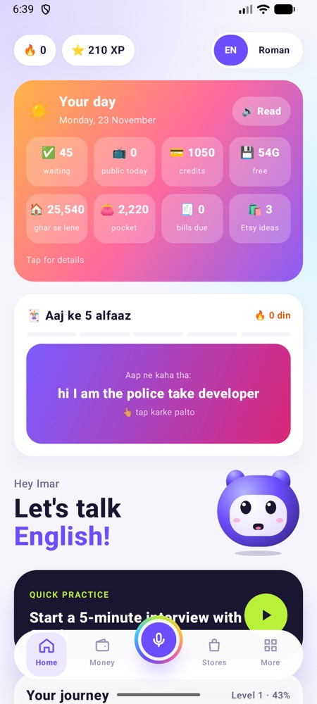
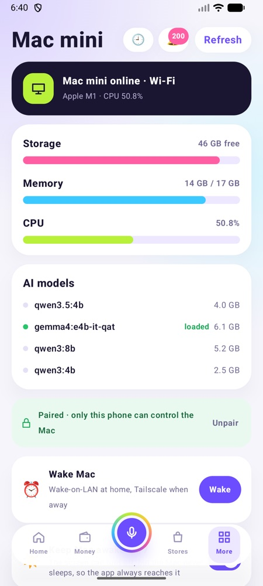
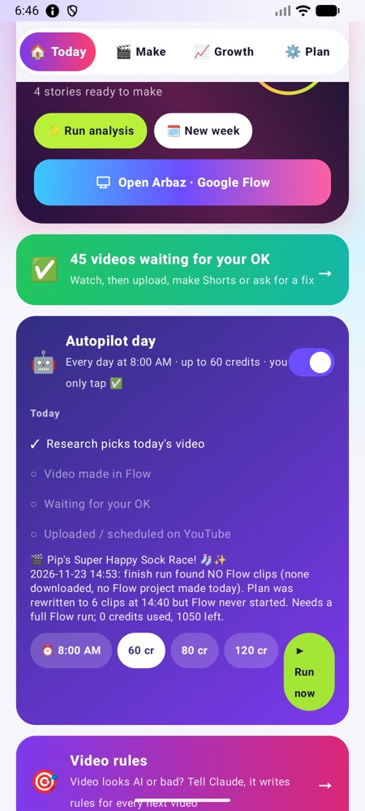
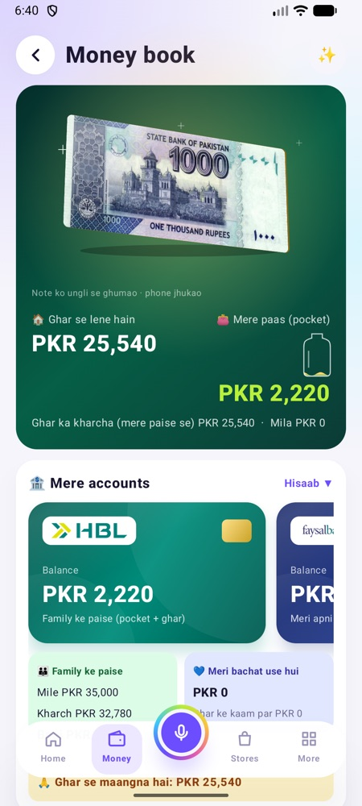

# Buddy

**Your own AI assistant that lives on your Mac and talks to your Android phone.**
Buddy runs on a Mac you own (local AI with Ollama and Whisper, plus Claude Code for real work), and the Buddy app on your
phone talks to it from anywhere over Tailscale. Nothing goes to a Buddy cloud: there isn't one.

Made by [Khanani Innovations](https://khananiinnovations.com/work/buddy).

| Home | Mac control | Studio | Money book |
|---|---|---|---|
|  |  |  |  |

## What it does

- **English coach**: speak or type, get your sentence corrected and the next question, with explanations in English,
  Roman Urdu or Urdu. Interview practice, pronunciation scores, streaks and XP. Offline mode on the phone when the Mac is off.
- **Mac assistant**: tell Buddy what to do in plain words (English or Roman Urdu, by voice too). A Claude Code agent on
  your Mac does it: opens apps and sites, works in Chrome, reads and writes files, and reports back.
- **Full Mac control from the phone**: live screen, touch/mouse/keyboard, scrolling, displays, volume, lock/wake,
  file transfer both ways, storage cleaner, routines ("Work", "Night"...).
- **YouTube Studio and autopilot** *(optional)*: plan, make (Google Flow), review and schedule videos from the phone,
  with a daily autopilot and a Flow credit guard.
- **Songs / naat videos** *(optional)*: import a Suno song and have a music video made in Google Flow.
- **Etsy Store Studio** *(optional)*: store numbers, product ideas and design images made with Gemini.
- **Money book**: spending, bills, family balance, receipt scanning, home-screen widgets.
- **CV Studio**: tailor your CV to a job and make a clean PDF.
- **Morning brief and alerts**: the Mac's news (video waiting, low storage, finished jobs) as phone notifications.

Security: the Mac only accepts phone requests signed with a secret made when you pair (a 6-digit code shown on the
Mac's screen), only from your Tailscale network or home Wi-Fi, and every request expires after 60 seconds.

## Requirements

| | |
|---|---|
| Mac | Apple Silicon (M1 or newer), macOS 14+, **16 GB RAM recommended**, ~20 GB free disk |
| Phone | Android 10 or newer |
| Network | [Tailscale](https://tailscale.com) (free) on the Mac and the phone |
| AI | [Claude Code](https://claude.com/claude-code) with a Claude plan (Pro or Max) for the Mac agent; Ollama and Whisper run locally for free |
| Optional | Google AI Pro + Chrome (Google Flow, YouTube autopilot), Gemini (Etsy designs), Suno (songs), ntfy |

## Install

```bash
git clone https://github.com/<you>/buddy.git ~/buddy
cd ~/buddy
./setup.sh
```

Then allow the Mac permissions it lists, install the APK from [Releases](../../releases) on your phone, and pair with
the 6-digit code. **Full step-by-step guide: [docs/SETUP.md](docs/SETUP.md).**

Check your setup any time:

```bash
./setup.sh --check
```

## Project layout

- `android/`: the Buddy app (Kotlin + Jetpack Compose). Kotlin package `com.englishcoach.app`, app id `com.khananiinnovations.buddy`.
- `server/`: the Mac server (Python standard library only, no pip installs) and small Swift helpers for screen, input and audio.
- `server/config.example.json`: every setting; your own copy is `server/config.json` (never committed).
- `setup.sh`: installs and checks everything, and runs the server as a LaunchAgent.

## Build the app yourself

```bash
cd android
JAVA_HOME="/Applications/Android Studio.app/Contents/jbr/Contents/Home" ./gradlew assembleDebug
# -> android/app/build/outputs/apk/debug/app-debug.apk
```
